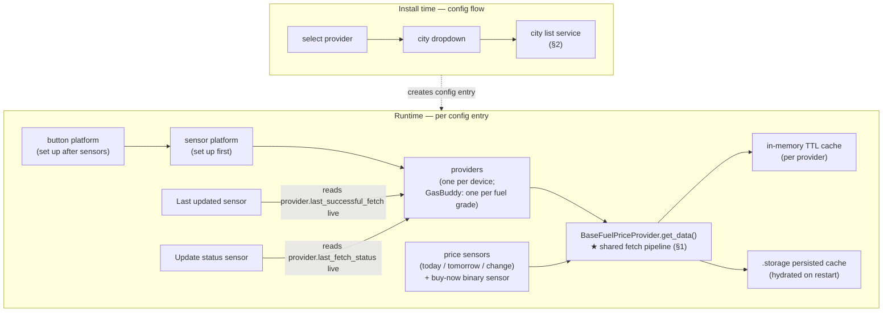
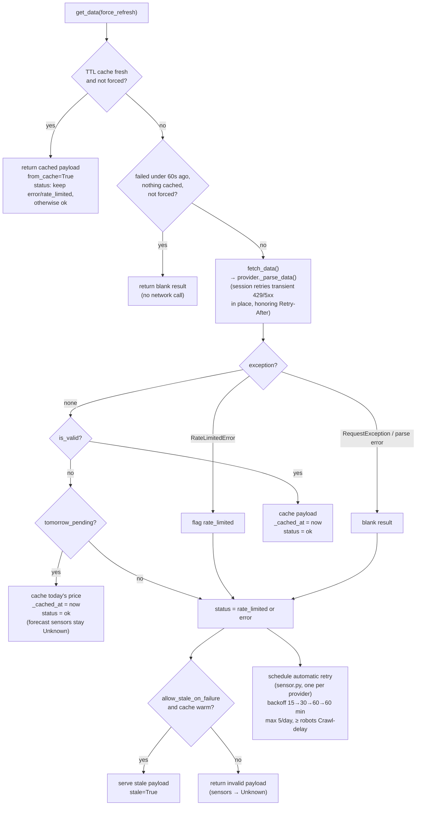
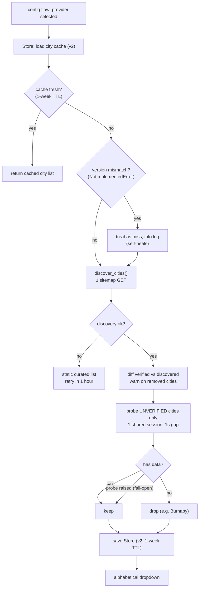
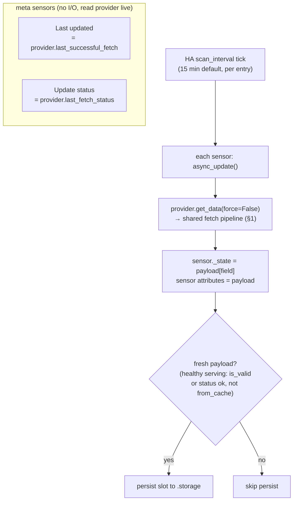
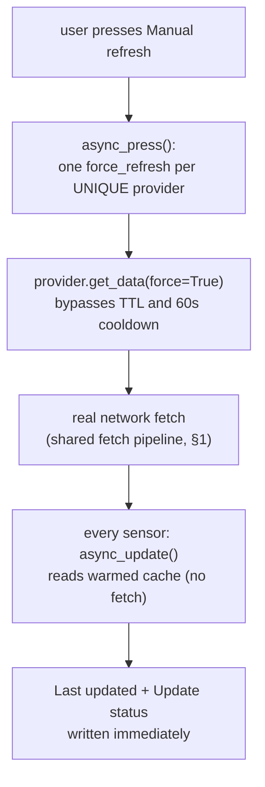

# Architecture

How the integration is put together and how data flows through it.
Diagrams are Mermaid (rendered natively by GitHub) and track the code as of **v2.6.1**.

- [0. Overview](#0-overview) — modules, who reuses what
- [1. Fetch pipeline](#1-fetch-pipeline) — the shared core every sensor uses
- [2. City list acquisition](#2-city-list-acquisition) — config-flow time
- [3. Scheduled updates](#3-scheduled-updates) — the 15-minute poll cycle
- [4. Manual refresh](#4-manual-refresh) — the button

## 0. Overview

Two phases. Install time builds the city dropdown; runtime serves sensor data.
The single most important thing on this map: **every sensor funnels through
`BaseFuelPriceProvider.get_data()`** — the fetch pipeline in §1. There is no
per-sensor fetching logic.

Notes:

- Platforms set up **sequentially** (sensors before button): the button builds
  its entities from the device info populated by the sensor platform, so
  ordering matters (`__init__.py` forwards one platform at a time).
- The two meta sensors (**Last updated**, **Update status**) do no I/O; they
  read provider state live, so they are correct even if they update before a
  slow provider's fetch lands.
- Retries/backoff policy (request politeness) is documented in
  [Providers](Providers.md); the mechanics are in §1 below.

## 1. Fetch pipeline

`get_data()` → `_get_data_locked()` in `providers/base.py`. Called by every
sensor on every poll and by the refresh button. The lock serializes concurrent
callers so duplicate network requests never fire.

Key semantics:

- **Cache hit is a healthy serving** — but it never whitewashes a failed
  source: if the last real attempt failed, the error status is kept.
- **`tomorrow_pending`** (GasWizard, v2.5.2+): the fetch succeeded and today's
  price is fresh, but tomorrow's forecast isn't published yet (routine every
  afternoon). Status is `ok` and **Last updated** advances; only forecast
  sensors read Unknown. Before v2.5.2 this was misreported as a failure.
- **60s retry cooldown** (v2.5.4+): an automatic retry seconds after a failure
  (nothing cached) would just fail again — it returns blank without a network
  call. Forced refreshes bypass it.
- **Transport-level retry** (v2.6.0+): the shared session mounts a urllib3
  `Retry` — transient 429/5xx responses are retried in place (up to 2
  attempts), honoring the server's `Retry-After` header. Seconds-scale;
  complements the application backoff below. 403 is *not* retried at this
  layer (it isn't transient).
- **Application-level retry** (v2.6.0+, #55): after a failed attempt
  (`error`/`rate_limited`), `sensor.py` schedules one retry per provider via
  `async_call_later` — backoff 15 → 30 → 60 → 60 minutes, max 5 per provider
  per day (counter persisted across restarts), never below the robots.txt
  `Crawl-delay`. One retry is shared across all of the provider's sensors;
  success resets the ladder; entry unload cancels the pending timer. The
  manual-refresh button cools down for 60 s after each press
  (`available=False`, `next_available_at` attribute).
- **Stale fallback** is opt-in per provider (`allow_stale_on_failure`, e.g.
  CityNews Calgary). GasWizard does not serve stale data: a genuine failure
  with no cache yields Unknown.
- Internal flags (`rate_limited`, `tomorrow_pending`) are popped before
  return and never leak into entity attributes.

## 2. City list acquisition

Runs in the **config flow** when a provider is selected — never at HA startup.
Never raises: any failure falls back to the provider's static curated list.

Key semantics:

- **Delta probing** (v2.5.5+): the 49 GasWizard slugs were verified twice, so
  only genuinely new sitemap cities are probed — today that's a single request
  (Burnaby), not fifty.
- **Removal detection** (v2.5.6+): verified cities missing from a successful
  discovery log a warning naming them.
- Probes are structural (≥1 dated entry), date-independent — a today-date
  check would false-negative before the evening forecast publish.

## 3. Scheduled updates

Each config entry polls on its `scan_interval` (15 minutes default, adjustable
in options). Every sensor's `async_update()` calls the shared pipeline above
with `force=False`, so the TTL cache decides whether the network is hit.

On HA restart, providers hydrate from the persisted `.storage` cache before the
first poll, so sensors (and **Last updated**) have data immediately; the first
poll then refreshes normally. GasBuddy station entries additionally run a
setup-time preview fetch (`get_data()`, not `fetch_data()`) so a brand-new
device isn't empty while waiting for its first tick — the warmed cache means
the first scheduled update doesn't fetch twice.

**Persist rule** (v2.6.1+): a slot is written for every *healthy serving* —
`is_valid` **or** the attempt's status is `ok`. Before v2.6.1 only `is_valid`
payloads were persisted, so GasWizard morning fetches (`tomorrow_pending`,
fresh today's price but forecast not yet published) never reached `.storage`;
after a restart **Last updated** fell back to the last evening persist, days
stale (#78).

## 4. Manual refresh

The per-device button forces exactly one fresh fetch per unique provider, then
lets every sensor re-read from the warmed cache.

Before v2.5.3 the button fanned out into one forced fetch *per sensor* — on a
slow source that meant N sequential timeouts. A genuinely failed refresh still
reports `Failed` (and sensors read Unknown when there is nothing cached);
v2.5.2+ no longer confuses "forecast not published yet" with failure.
v2.6.0+ adds a 60 s post-press cooldown: the button reports
`available=False` (greyed out in the UI) with a `next_available_at`
attribute, so a struggling source can't be hammered by repeated taps.
